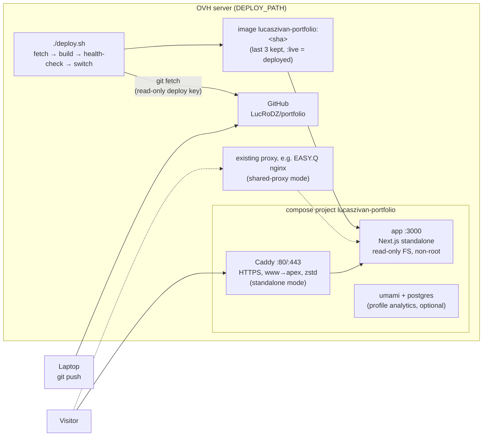

# Portfolio — Lucas Zivan

Source of [lucaszivan.app](https://lucaszivan.app). Next.js 16 (App Router, statically generated pages), Tailwind CSS v4, TypeScript. No client-side animation or 3D libraries. Self-hosted on an OVH server with Docker — see [Deployment](#deployment).

## Scripts

```bash
npm run dev             # http://localhost:3000 (redirects to /en or /fr)
npm run build           # production build
npm start               # serve the build
npm test                # unit tests (Vitest)
npm run lint
npm run check:links     # crawl a running build; set BASE_URL (default http://localhost:3000)
npm run check:contrast  # WCAG contrast of the colour tokens
```

Copy `.env.example` to `.env.local` for the optional settings (site URL, booking link, analytics).

## Where things live

| Path | What |
|---|---|
| `content/dictionaries/{en,fr}.ts` | Every UI string. `fr.ts` is typed against `en.ts`, so a missing key fails the build. |
| `content/projects.ts` | Case studies and the "More projects" list, with the source of each fact. |
| `content/experience.ts`, `content/skills.ts`, `content/site.ts` | Timeline, skill tiers, e-mail / links / CV paths. |
| `app/tokens.css` | Design tokens: colours (light + dark), type scale, radius, widths. The only place raw values live (plus `lib/brand.ts` for OG images). |
| `app/[locale]/` | Routes: home, `projects/[slug]`, OG images, 404. |
| `proxy.ts` | Redirects locale-less URLs using `Accept-Language`, EN fallback. |
| `lib/` | i18n, SEO/JSON-LD, analytics, security headers/CSP, diagram layout, TODO handling — all unit-tested in `tests/`. |
| `Dockerfile`, `docker-compose.prod.yml`, `docker-compose.shared-proxy.yml`, `deploy/` | Container, production stack, Caddy and nginx configs. |
| `deploy.sh`, `scripts/server-setup.sh` | Deploy on the server; one-time server setup. |
| `docs/` | Design audit, before/after screenshots, copy options. |

## Placeholders

Unknown facts are written as `TODO(lucas): …`. They are outlined in development and left out of production builds, and `check:links` fails if one reaches the HTML. Find them with:

```bash
grep -rn "TODO(lucas)" content
```

## Deployment

Self-hosted on the OVH server. No CI/CD, no registry: the server builds the image from `origin/main` itself.



### Why a Node container and not a static export

The pages are pre-rendered, but `proxy.ts` (Accept-Language → `/en` or `/fr`), the localized 404 for unknown paths and `/api/health` need a server, and `output: "export"` does not support them. A static Caddy image would be smaller (~25 MB base vs 63 MB), but moving locale negotiation into proxy config would lose the tested q-value logic and break shared-proxy mode, where nginx is not ours to configure. The standalone server costs ~62 MB RAM and starts in under a second.

### What replaced Vercel

| Vercel-specific | Status here |
|---|---|
| `vercel.json`, Edge runtime, ISR / `revalidate`, image domains | None were used. |
| `@vercel/analytics` | Not used. Cookieless Plausible/Umami via `NEXT_PUBLIC_ANALYTICS`; optional self-hosted Umami as compose profile `analytics`. |
| `@vercel/og` | OG images use `next/og` on the Node runtime and are pre-rendered at build time. |
| `next/image` optimisation (sharp) | Not used, so sharp is excluded from the image. |
| Automatic HTTPS, www redirect, compression | Caddy (standalone) or the existing proxy (shared-proxy). |
| Security headers | Set by the app (`lib/security.ts`), so they are identical in both modes. |
| Preview/production env vars | `.env` on the server. `NEXT_PUBLIC_*` are build-time (passed as build args); runtime settings live in `docker-compose.prod.yml`. |

### Proxy modes (`PROXY_MODE` in `.env`)

- **`standalone`** (default): Caddy binds 80/443 and gets Let's Encrypt certificates automatically. `deploy.sh` refuses to start if another process already holds those ports.
- **`shared-proxy`**: no Caddy. The app joins the existing proxy's Docker network (`SHARED_PROXY_NETWORK`) as `lucaszivan-portfolio-app:3000`. Use this when EASY.Q's nginx already owns 80/443 on the server — see [Shared-proxy mode](#shared-proxy-mode-behind-easyqs-nginx).

### First-time setup (once)

1. **DNS** (OVH Control Panel → Domains → lucaszivan.app → DNS zone): `A` records for `lucaszivan.app` and `www.lucaszivan.app` → server IPv4; `AAAA` only if the server has IPv6 that answers on 80/443. Delete the old Vercel records. Use TTL 300 during the switch, 3600 afterwards. Check with `dig +short A lucaszivan.app @1.1.1.1` (and `www.`) until both show the server IP.
2. **Server**: copy and run the setup script as your sudo user (it asks before every command):
   ```bash
   scp scripts/server-setup.sh ubuntu@<server>:~ && ssh ubuntu@<server> ./server-setup.sh
   ```
   It installs Docker if missing, creates the `deploy` user, generates a **read-only deploy key** (you paste the public key into GitHub → repo → Settings → Deploy keys, *Allow write access* unchecked), clones the repo into `/srv/lucaszivan-portfolio`, copies `.env.example` to `.env`, adds missing UFW rules (never resets them) and prints the DNS records.
   *Note:* membership of the `docker` group is equivalent to root on the host. The `deploy` user still keeps deploys and GitHub keys off your personal account.
3. **Configure** `/srv/lucaszivan-portfolio/.env` (chmod 600): `DOMAIN`, `PROXY_MODE`, `ACME_EMAIL`, `DEPLOY_BRANCH`, and `SHARED_PROXY_NETWORK` in shared-proxy mode.
4. **First deploy**, as `deploy`: `cd /srv/lucaszivan-portfolio && ./deploy.sh --dry-run && ./deploy.sh`.

### Daily routine

```bash
git push                                   # laptop
ssh deploy@<server>                        # or: ssh ubuntu@<server> then sudo -iu deploy
cd /srv/lucaszivan-portfolio && git pull && ./deploy.sh
```

`deploy.sh` fetches `origin/$DEPLOY_BRANCH` again and refuses to deploy a dirty working copy or local commits (`--force` discards them). It builds `lucaszivan-portfolio:<sha>`, starts it as a candidate and waits for it to be healthy with `/en` and `/fr` rendering. Only then does it recreate the live container (Caddy holds requests for the ~1 s switch; tested with 0 failed requests) and run the smoke test (200s, security headers, certificate). Running it again with nothing new is a no-op.

| Command | Does |
|---|---|
| `./deploy.sh --dry-run` | Checks + plan, changes nothing. |
| `./deploy.sh --force` | Rebuild and redeploy the same commit. |
| `./deploy.sh --rollback` | Switch back to the previously deployed image (last 3 kept). The next normal deploy goes back to `origin/main`, so revert the bad commit first. |
| `./deploy.sh --status` | Deployed SHA, containers, images, recent deploys. |
| `./deploy.sh --logs` | Follow this project's logs (`LOG_LINES=300` for more history). |

### Shared-proxy mode (behind EASY.Q's nginx)

1. Find EASY.Q's network: `docker inspect <easyq nginx container> -f '{{json .NetworkSettings.Networks}}'` (e.g. `easy-q_default`), and set `PROXY_MODE=shared-proxy` and `SHARED_PROXY_NETWORK=<that name>` in `.env`.
2. `./deploy.sh` — the app joins that network as `lucaszivan-portfolio-app`. The smoke test fails until step 4 is done.
3. Copy `deploy/nginx/lucaszivan.app.conf` into EASY.Q's nginx config. That file references certificates that don't exist yet, so first issue them with the HTTP-only block: with EASY.Q's certbot setup (webroot `/var/www/certbot`) run, from the EASY.Q directory,
   `docker compose run --rm certbot certonly --webroot -w /var/www/certbot -d lucaszivan.app -d www.lucaszivan.app` (adapt to how EASY.Q runs certbot — it is EASY.Q's stack, so this step is manual).
4. Add the HTTPS blocks, then `docker compose exec nginx nginx -t && docker compose exec nginx nginx -s reload` in EASY.Q's directory. `http2 on;` needs nginx ≥ 1.25.1.
5. `./deploy.sh --force` to re-run the smoke test.

Traefik users: the labels in `docker-compose.shared-proxy.yml` are picked up automatically (`TRAEFIK_CERTRESOLVER`).

### Troubleshooting

- **Certificate not issued (standalone)**: `./deploy.sh --logs` and look for `acme` errors. Usual causes: DNS not pointing here yet, port 80 blocked (UFW or OVH network firewall), an AAAA record pointing elsewhere, or a Let's Encrypt rate limit after many failed tries (wait an hour). The site is healthy meanwhile; rerun `./deploy.sh --force` to re-check.
- **"Port 80/443 is already used"**: another stack owns them (`sudo ss -tlnp 'sport = :443'`). Use shared-proxy mode; `deploy.sh` never stops other containers.
- **Health check fails**: the old version keeps serving. The last 50 log lines are printed. Reproduce with `docker run --rm -p 3000:3000 lucaszivan-portfolio:<sha>` and `curl localhost:3000/api/health`.
- **Disk full**: `deploy.sh` aborts below `MIN_FREE_DISK_MB`. It prunes only its own images. Shared build cache: `docker system df`, then `docker builder prune` if you accept clearing other projects' cache too.
- **"Refusing to deploy a working copy that differs"**: someone edited files on the server. `git status` / `git diff` to look, then push the change from your laptop or run `./deploy.sh --force` to discard it.
- **git fetch fails**: `git remote -v` must use the `github-lucaszivan-portfolio` alias; test with `ssh -T git@github-lucaszivan-portfolio`.
- **Signed commits**: with `REQUIRE_SIGNED_COMMITS=true`, the server needs your public GPG/SSH signing key (`gpg --import`, or `gpg.ssh.allowedSignersFile` for SSH signatures).
